<div align="center">


<br/>

<a href="#-youcam-api-integration"></a>


<h3>
  <a href="#-see-it-in-action">Demo</a> ·
  <a href="#-what-makes-it-different">What's different</a> ·
  <a href="#-youcam-api-integration">YouCam APIs</a> ·
  <a href="#-architecture">Architecture</a> ·
  <a href="#-run-it-in-60-seconds">Run it</a>
</h3>

<sub>Built for the <b>YouCam API Skin AI &amp; eCommerce VTO Hackathon</b> by Perfect Corp.</sub>

</div>

<br/>

> [!IMPORTANT]
> **The one-line pitch:** most virtual try-ons show you *a* colour. Vanakkam shows you **the exact product you're about to buy**, chosen for your measured skin, the outfit you're wearing and the lighting at your event, with a **CIEDE2000 match score** on every shade.

<br/>

## 🎬 See it in action

<div align="center">
  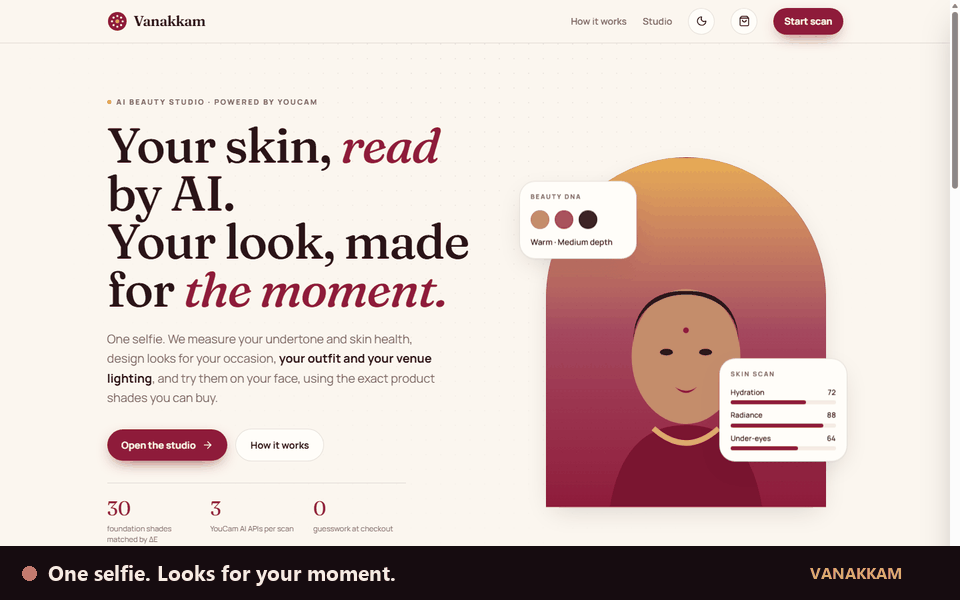
  <br/><sub>Occasion → selfie → YouCam scan → Beauty DNA → outfit-aware try-on → shade-matched kit → checkout</sub>
</div>

<br/>

<div align="center">
  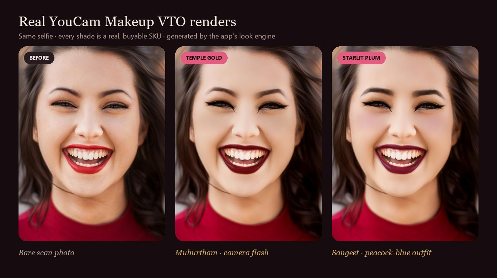
</div>

<br/>

## 💔 The problem

Big beauty purchases in India happen around a **date**: a wedding muhurtham, a sangeet, Diwali. Buying them online goes wrong in three ways:

<table>
<tr>
<td width="33%" valign="top">

### 📦 Wrong shade, sent back
Foundation and lipstick shades are hard to judge on a screen. Shoppers guess, the colour arrives wrong, and it goes back.

</td>
<td width="33%" valign="top">

### 👗 Looks that fight the outfit
A coral lip next to a peacock-blue saree. Recommendations ignore what the person is actually **wearing**.

</td>
<td width="33%" valign="top">

### 📸 Flat under the flash
Temple photographers, stage lights and daylight each change how makeup reads. Try-ons assume perfect studio light.

</td>
</tr>
</table>

## ✨ What makes it different

<table>
<tr><td width="50"><h2>🎯</h2></td><td>

**Try-on = Buy.** Every AI-designed shade is **snapped to the nearest real SKU with CIEDE2000** (the colour-difference formula the cosmetics industry uses). The YouCam render uses *that SKU's exact hex*, so what you see is what arrives. Each product shows its **% match and ΔE**, and the foundation gets a **runner-up shade**.

</td></tr>
<tr><td><h2>🛡️</h2></td><td>

**Shade Confidence score.** A weighted kit score (base 50%, lips 30%, cheeks and brows 10% each) tells the shopper how likely the shades are to be right **before** checkout.

</td></tr>
<tr><td><h2>👗</h2></td><td>

**Outfit harmony.** Pick a saree or lehenga colour, **or upload a photo of it**: the dominant fabric colour is extracted in the browser. Lips swap shade family to avoid clashes, lids pick up the outfit colour, and every change re-renders on your face.

</td></tr>
<tr><td><h2>💡</h2></td><td>

**Lighting-aware looks.** *Camera flash* raises lip and blush intensity and cuts glow to prevent flashback. *Stage lights* boost shimmer. *Daylight* softens everything. Switch the lighting and YouCam re-renders.

</td></tr>
<tr><td><h2>🧴</h2></td><td>

**Your skin scores become a shopping list.** Your **3 lowest** of 9 YouCam skin scores each map to one regimen product, with an **order-by date** and a supply check against the days left to your event.

</td></tr>
<tr><td><h2>🗓️</h2></td><td>

**Countdown prep plan.** A day-by-day ritual from 4 weeks out to the morning of, including tips like *"no zinc SPF under flash"*. Exports to any calendar as `.ics`.

</td></tr>
<tr><td><h2>🪷</h2></td><td>

**Made for the moment.** 6 occasions × 3 looks: Muhurtham, Mehendi &amp; Haldi, Sangeet &amp; Reception, Festival (Diwali · Pongal · Onam · Eid), Everyday, Date Night. Every render is honestly labelled *"AI try-on preview"*.

</td></tr>
</table>

<br/>

<div align="center">
  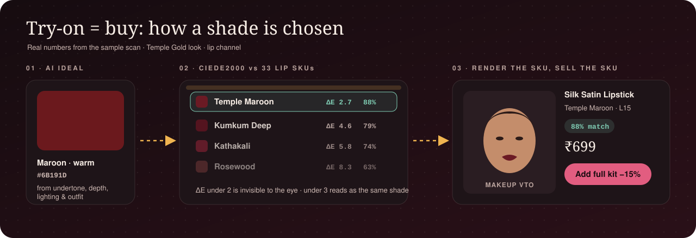
</div>

<br/>

## 🧬 YouCam API integration

<div align="center">

| | API | Endpoint | What Vanakkam does with it |
|:-:|---|---|---|
| 🎨 | **AI Skin Tone Analysis** | `task/skin-tone-analysis` | Skin, lip and brow hex → **CIE Lab** → undertone (b\*/a\* ratio) and depth (L\*) → foundation and brow matching, plus a **nude lip built from your own lip colour** |
| 🔬 | **AI Skin Analysis** | `task/skin-analysis` | 9 concern scores, skin age, skin type and an overall score → base **coverage and glow tuning**, the regimen products and the prep plan |
| 💄 | **AI Makeup VTO** | `task/makeup-vto` | **6 categories per render**: foundation, blush, eye shadow (1–3 colour patterns), shaped eyebrows, lip colour (matte, satin or gloss) and liner. Re-rendered on every tweak, lighting change and outfit change |
| 📁 | File API | `POST /file` + signed `PUT` | **One upload, reused** by every task in the session |

</div>

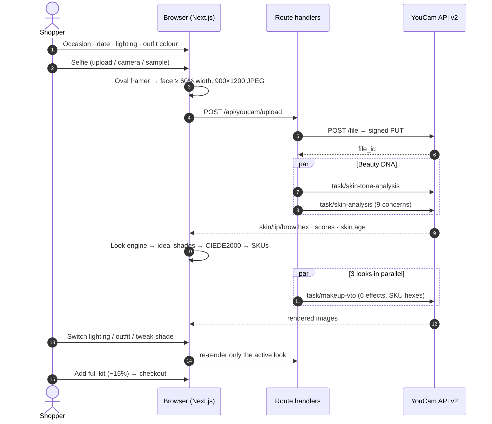

<details>
<summary><b>🔍 See a real Makeup VTO payload produced by the look engine</b></summary>

<br/>

This is the *Temple Gold* look for the sample scan, under camera flash, with an emerald outfit. Every hex is a catalogue SKU:

```jsonc
{
  "version": "1.0",
  "effects": [
    { "category": "foundation", "palettes": [{ "color": "#ba8f72", "colorIntensity": 45, "glowIntensity": 17, "coverageIntensity": 75 }] }, // 28N · 89% match
    { "category": "blush", "pattern": { "name": "1color1" }, "palettes": [{ "color": "#a8714c", "texture": "matte", "colorIntensity": 50 }] },
    { "category": "eye_shadow", "pattern": { "name": "2colors1" }, "palettes": [
        { "color": "#1f5a46", "texture": "matte", "colorIntensity": 65 },                                           // lid picks up the outfit
        { "color": "#c9a14a", "texture": "shimmer", "shimmerColor": "#fff3d1", "shimmerIntensity": 40, "colorIntensity": 65 } ] },
    { "category": "eyebrows", "pattern": { "type": "shape", "name": "SoftArch1", "curvature": 0, "thickness": 5, "definition": 35 }, "palettes": [{ "color": "#5b5352", "colorIntensity": 45, "texture": "matte" }] },
    { "category": "lip_color", "shape": { "name": "original" }, "style": { "type": "full" }, "palettes": [{ "color": "#6b1a24", "texture": "satin", "colorIntensity": 86 }] }, // Temple Maroon
    { "category": "eye_liner", "pattern": { "name": "Arabic3" }, "palettes": [{ "color": "#141010", "texture": "matte", "colorIntensity": 80 }] }
  ]
}
```

Before building on them, we checked every pattern and texture combination against the live API: `1color1`/`2colors1`/`3colors1` eye shadow, `Arabic3`/`2colors1` liner, `SoftArch1`/`HighArch1`/`Straight1` brows, and matte/satin/gloss lips.

</details>

## 🏗️ Architecture

<div align="center">
  
</div>

### The look engine

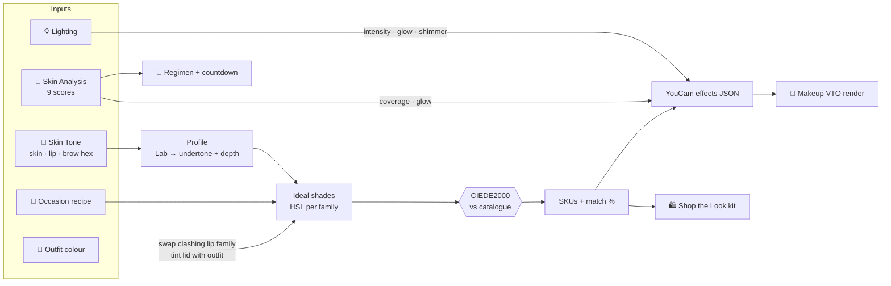

<details>
<summary><b>🎨 The colour science, briefly</b></summary>

<br/>

| Step | Implementation (`lib/color.ts`) |
|---|---|
| sRGB → CIE Lab (D65) | Linearise, apply the XYZ matrix, then the Lab transform |
| **Undertone** | `b*/a*` of the measured skin colour: above 1.6 → warm, below 1.15 → cool, otherwise neutral |
| **Depth** | `L*` above 70 → fair, above 52 → medium, otherwise deep |
| **Shade distance** | Full **CIEDE2000** (ΔE00) with the hue-rotation term `R_T`. Under 2 is imperceptible |
| Match % | `max(50, 100 − 4.5·ΔE00)` |
| Outfit colour from a photo | 3-bit RGB histogram over the centre 60% of the image, weighted toward saturated buckets so the fabric wins over the background |
| Foundation range | 60 shades: 20 depths interpolated from a measured skin ramp × warm, neutral and cool |

</details>

<details>
<summary><b>💡 How lighting and skin scores change a look</b></summary>

<br/>

| Signal | Lips | Eyes | Blush | Glow | Coverage | Shimmer |
|---|:-:|:-:|:-:|:-:|:-:|:-:|
| 📸 Camera flash | **+8** | 0 | **+10** | **−18** | +10 | −15 |
| 🎤 Stage lights | +4 | **+10** | 0 | +5 | 0 | **+15** |
| ☀️ Daylight | −8 | −10 | −5 | +10 | −10 | 0 |
| Texture below 70 or pores below 65 | | | | | **+10** | |
| Oil balance below 60 | | | | **−15** | | |
| Radiance below 70 or hydration below 65 | | | | **+12** | | |

</details>

## 🖼️ Screens

<table>
<tr>
<td width="50%">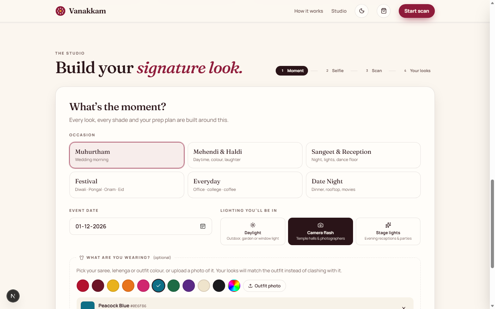<p align="center"><sub><b>Moment:</b> occasion · date · lighting · outfit</sub></p></td>
<td width="50%">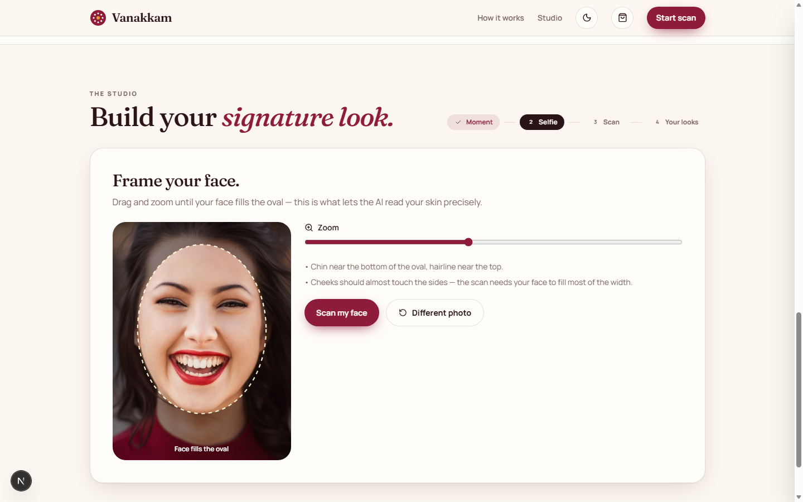<p align="center"><sub><b>Oval framer:</b> passes skin-analysis requirements first time</sub></p></td>
</tr>
<tr>
<td>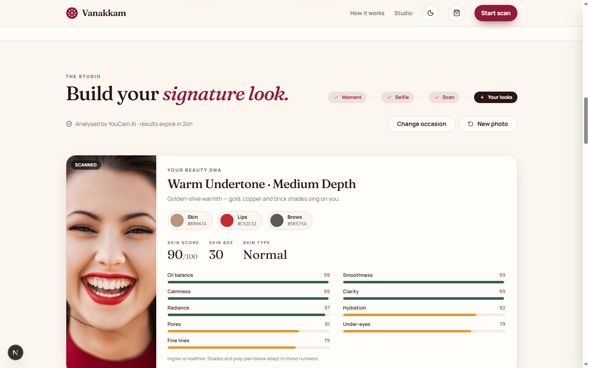<p align="center"><sub><b>Beauty DNA:</b> undertone, depth, 9 skin scores</sub></p></td>
<td>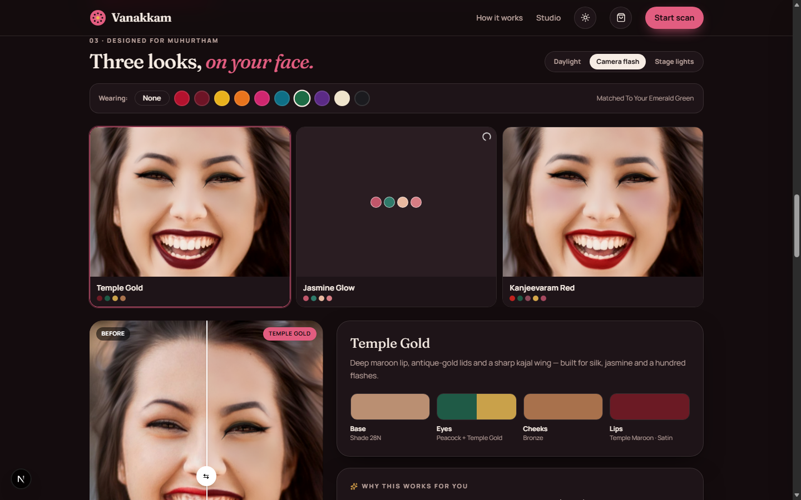<p align="center"><sub><b>Three looks:</b> live lighting and outfit switcher</sub></p></td>
</tr>
<tr>
<td>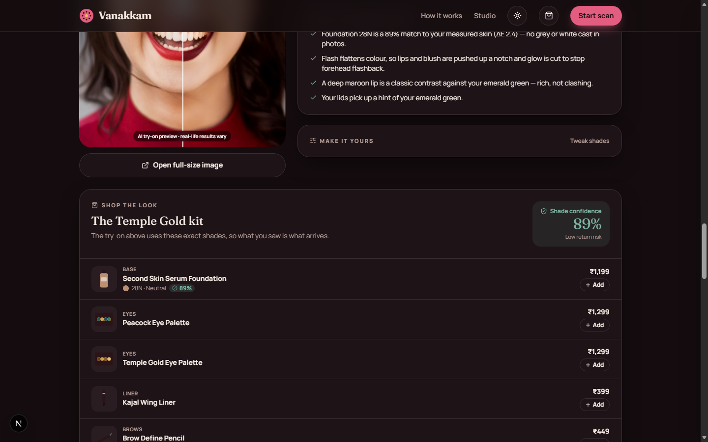<p align="center"><sub><b>Shop the Look:</b> 89% shade confidence, ΔE per SKU</sub></p></td>
<td>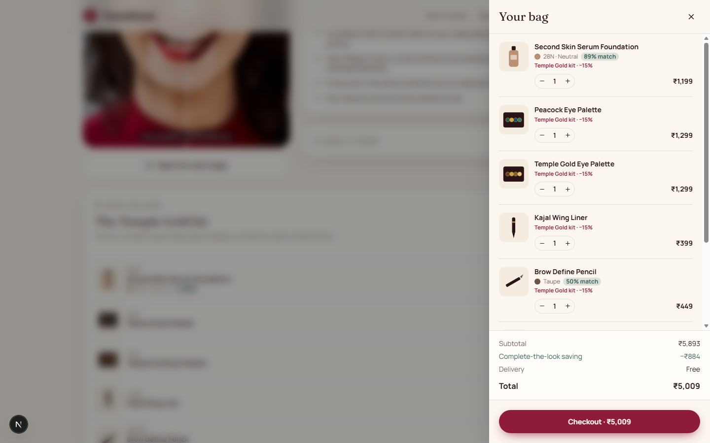<p align="center"><sub><b>Bag:</b> bundle pricing · delivery vs event date</sub></p></td>
</tr>
</table>

<details>
<summary><b>🌗 Light and dark heroes</b></summary>
<br/>
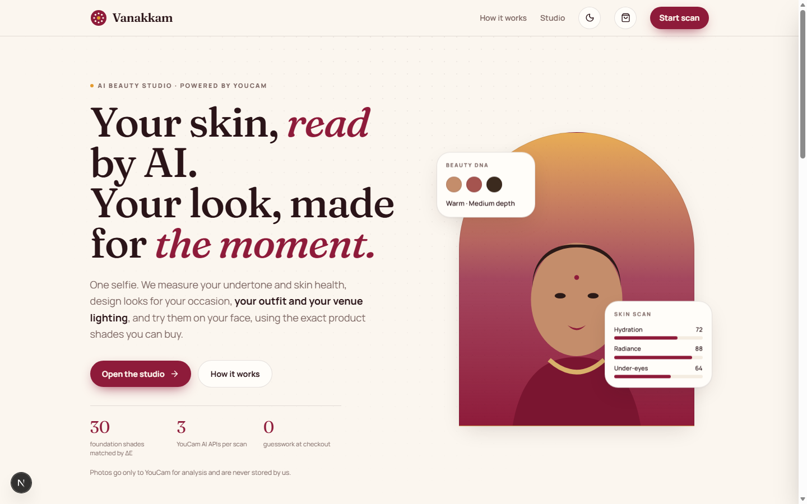 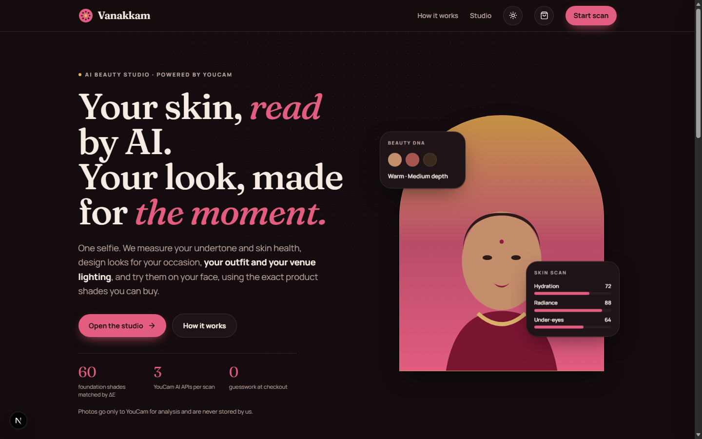
</details>

## 🏆 Built for the judging criteria

| Criterion | Where to look |
|---|---|
| **Technological implementation** | 3 YouCam APIs on one `file_id` · parallel tasks with backoff polling · 6-category VTO payloads generated from data · CIEDE2000 written from scratch · server-only key with a feature allow-list · friendly mapping of YouCam error codes · de-duplicated renders |
| **Design** | A complete storefront, not a demo screen: guided 4-step studio, before/after slider, dark mode, mobile-first, illustrated packshots, accessible controls (`aria-pressed`, live regions, reduced-motion support) |
| **Potential impact** | Targets shade-mismatch returns (match % + runner-up), outfit clashes and lighting failures for India's occasion-driven beauty shopping. The skin scan turns straight into a regimen basket |
| **Quality of idea** | *Try-on = buy* SKU snapping, *outfit harmony* from a garment photo, *lighting-aware* rendering, and a *countdown commerce* plan tied to a real event date |

## 🚀 Run it in 60 seconds

```bash
git clone https://github.com/Noufalthecoder/vanakkam.git
cd vanakkam
pnpm install
cp .env.example .env.local      # paste your YOUCAM_API_KEY
pnpm dev                        # → http://localhost:3000
```

> [!TIP]
> No selfie handy? Click **"Try a sample model"** in the studio.
> On Windows you can also just run `run.bat` / `run.ps1`.

| Variable | Required | Default |
|---|:-:|---|
| `YOUCAM_API_KEY` | ✅ | |
| `YOUCAM_API_BASE` | | `https://yce-api-01.makeupar.com/s2s/v2.0`. For the global console, use `https://yce-api-01.perfectcorp.com/s2s/v2.0` |

**Deploy on Vercel:** import the repo, add `YOUCAM_API_KEY`, and deploy. There is no database and no extra services.

<details>
<summary><b>📂 Code map</b></summary>

```
app/
  api/youcam/upload/route.ts   upload proxy (type and size validation)
  api/youcam/task/route.ts     create + poll tasks (feature allow-list)
  page.tsx · layout.tsx        landing + studio, fonts, theme bootstrap
lib/
  youcam.ts                    YouCam REST client (server only)
  client.ts                    browser polling client + friendly errors
  beauty.ts                    profile, occasions, lighting, outfit harmony, look → effects
  catalog.ts                   house-brand catalogue, 60-shade foundation range, ΔE snapping
  color.ts                     sRGB ↔ HSL ↔ Lab, CIEDE2000, dominant colour
  plan.ts                      countdown plan from skin scores
  cart.tsx                     cart state, bundle pricing, delivery window
components/
  landing.tsx                  header, hero, why-it-matters, how-it-works
  studio/                      moment · photo (framer + camera) · scan · results
  shop/                        shop-the-look · regimen · cart drawer · product art
docs/assets/                   banner, architecture, pipeline, demo GIF
```

</details>

## 🛣️ What's next

- [ ] Plug in a retailer's live catalogue. ΔE snapping already works on any list of SKU hex values
- [ ] Add YouCam **hair colour** and **jewellery** try-on to complete the outfit
- [ ] Re-scan during the countdown and chart how the skin scores change
- [ ] A shareable "Beauty DNA" card for in-store shade matching

## 🙏 Credits

- **[YouCam API](https://yce.perfectcorp.com/)** by Perfect Corp.: Skin Analysis, Skin Tone Analysis, Makeup VTO.
- The sample model photo is from [Unsplash](https://unsplash.com/license), used under the Unsplash License.
- *Vanakkam Beauty* is a fictional house brand used for the demo store. No third-party trademarks are used.
- Skin insights are cosmetic guidance, **not medical advice**.

<div align="center">
<br/>
<sub>Made with 🌼 in India · MIT licensed</sub>
<br/><br/>
<b>வணக்கம் · Vanakkam</b>: a greeting, and an invitation to look like yourself.
</div>
